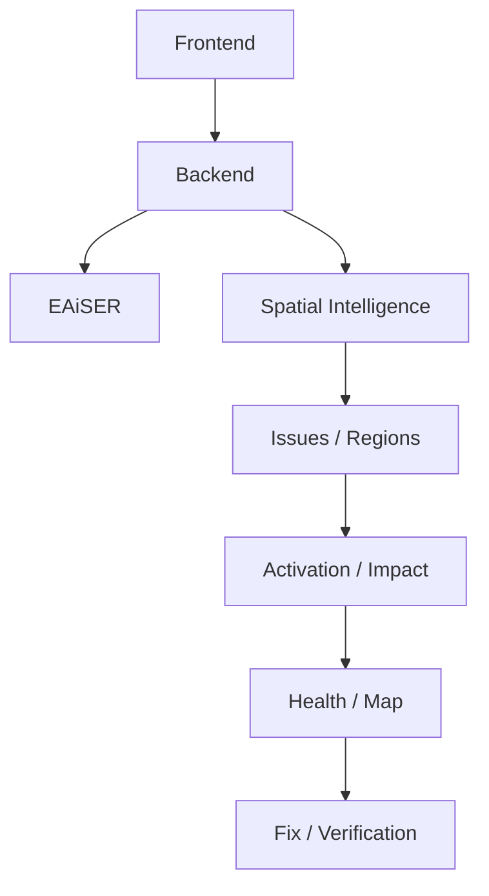

# Wakefield integration layer

This package is an isolated, dependency-free implementation of Wakefield's spatial intelligence, activation, impact, health, duplicate-suggestion, and demo-reset contracts. The repository is currently a different Python RAG application, so no existing Wakefield backend or EAiSER API was available to connect.

Prototype SJSU polygons are GeoJSON-compatible approximations and must not be represented as authoritative university GIS data. Coordinates are `[longitude, latitude]`.

## Run

From the repository root:

```bash
python3 -m unittest discover -s tests -v
python3 -m wakefield.demo_reset
```

The reset is isolated to an in-memory demo repository; it cannot erase production data. The `WakefieldService` exposes the requested async interface plus `create_issue`, `confirm_duplicate`, `mark_fixed`, and `map_state` integration helpers. Production persistence should implement the adapter surface in `repository.py` and keep duplicate confirmation explicit.

See [contracts.md](contracts.md) for precise JSON inputs/outputs and persistence assumptions.

## Demo contract

1. Reset the demo.
2. Submit a `blocked_pathway` report in MLK Library with high severity, accessibility impact, and critical-route impact.
3. The issue applies 30 HP damage and the map state reports MLK Library active (demo baseline `+1` plus high severity `+3` plus accessibility `+2`).
4. Mark it fixed; it remains `awaiting_verification` and HP remains 70.
5. Verify the repair; it becomes resolved, HP returns to 100, and the region is retained as recovered.

## Architecture



EAiSER, signed uploads, external persistence, realtime subscriptions, credits, and frontend rendering remain unconnected because this repository contains none of those modules or credentials. The package intentionally provides deterministic adapters and contracts for the other workstreams to connect.
